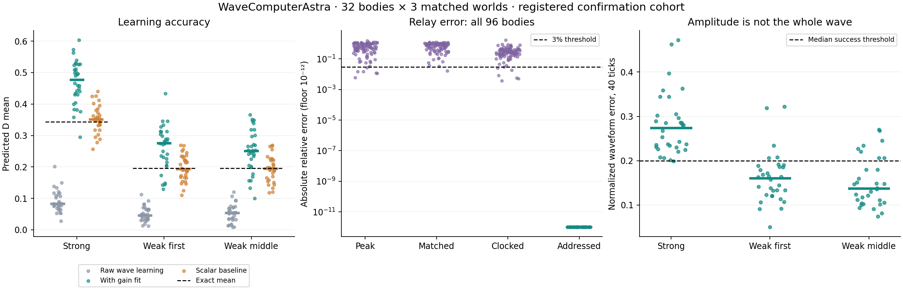

# WaveComputerAstra

A four-event wave computer that separates **what is predicted, how strongly,
when to relay it, and which branch wrote it**.

Antti Luode's wave-computer research · implementation and experiments by OpenAI
Codex/Astra · 17 November 2026. Built on the verified wave physics and node banks
from [WaveComputer](https://github.com/anttiluode/WaveComputer).

The experiment asks whether A → imagined B → imagined C → D preserves each
body's learned uncertainty. It compares six relay designs, cuts both intermediate
links, tests contradictory real evidence, and checks every body's error. The
addressed version explicitly needs event slots and writer channels. It does not
discover those for itself.

**Built and tested: the addressed relay works in all 96 bodies. The complete
machine does not pass every registered accuracy test.** It preserves what it
learned through two imagined steps, but still learns biased amplitudes and
imperfect wave shapes. Ordinary scalar regression is more accurate on this task.

[Protocol](PROTOCOL.md) · [engine](astra/chain.py) · [experiment](experiments/body.py)
· [analysis](experiments/analyze.py) · [provenance](SOURCES.md)

[Full report](REPORT.md) · [raw receipts](results/confirm.json) ·
[summary](results/confirm_summary.json) · [verification](results/verification.json)



## What survived the test

The protocol and executable tests were [published before the confirmation run](https://github.com/anttiluode/WaveComputerAstra/commit/ee928ed40d8c0668df7fc91b99d33a2af03343fc).
Thirty-two bodies in each of three matched worlds, six relay designs, one fitted
weight set per body. The full cohort took 439 seconds on this CPU environment.

- **96/96 preserve their measured learned-link amplitudes**, with maximum relative
  discrepancy below 1e-15. This is a verified consequence of the engineered linear
  channels and supplied clocks, not a discovery of error-free general reasoning.
- **96/96 need both intermediate relays:** cutting either removes the addressed D
  output. Real contradictory B and real contradictory C each reverse D in 96/96.
- Weakening A→B reduces D by a median factor **0.570**; weakening B→C gives **0.541**.
  The exact factor is **0.571**. Both registered confidence-response tests pass.
- All three worlds pass the relay, causal, and evidence-reversal rules. The
  **strong world fails amplitude accuracy and full waveform accuracy**.

| World | Exact D mean | Median wave D | Median absolute error | Scalar baseline error |
|---|---:|---:|---:|---:|
| Strong links | .343 | .478 | .135 | .023 |
| Weaker first link | .196 | .276 | .080 | .030 |
| Weaker middle link | .196 | .251 | .057 | .029 |

Errors are medians of individual absolute errors, not absolute signed medians.
Passing the weaker-world thresholds does not mean perfect calibration.

**The useful insight:** signal strength and timing are not enough if a reader
mistakes another branch's wave for its input. With the same weights, clocked
mixed-field relay has median transfer errors of 21%, 25%, and 42%; addressed
input/output selection removes that composition error in every tested body.
The next problem is the learner and waveform fidelity, not simply another link.

## Run locally

Python 3.10+; CPU only. From the repository directory:

```sh
python -m pip install -r requirements.txt
python -m unittest discover -s tests -v
python -m experiments.run --cohort smoke --workers 2
python -m experiments.demo --seed 310001 --mode routed --probe cut_B
```

The core runtime uses NumPy only. OpenCV is for checking the vendored nodes and
rebuilding the wave kernel. A smoke run trains three bodies. The complete fixed
cohort is `python -m experiments.run --cohort confirm --workers 2`.
Existing receipts are never overwritten; use `--output results/new_run.json`.

Open **[index.html](index.html)** directly in your browser for the offline results
viewer. It shows recorded measurements, with selectors for body, world, relay,
and causal intervention. To rerun a stored body and export actual wave traces:

```sh
python -m experiments.demo --seed 310001 --mode routed --output my_trace.csv
python -m experiments.verify --retrain
```

Eight engine tests pass. The saved summary recomputes exactly, a fresh body
retrain is identical, and six selected runs agree with the original grid node
within 2.7e-7 relative error. Those checks did not reach the grid's clipping limit.
Optional figure regeneration needs Matplotlib: `python -m experiments.figure`.

## Design

Each adjacent link has positive and negative fade-clock banks, with branches
that write into the wave field. Branches first learn from shared prediction
minus sensory target at their tips. A second, explicit training-only regression
fits six amplitude gains using local waveform projections.

The main relay uses a supplied event clock and a causal 20-tick signed template
projection. The pulse's magnitude carries the measured conditional mean. Its
input is the preceding branch's addressed wave component; its output remains
a physical impulse response, not a scalar multiplier substituted for a field.
An independent scalar composition is used only as an audit reference.

Mixed-field, peak-confidence, constant-confidence, and silent alternatives use
the same fitted weights. The total field is retained alongside addressed output.
This makes the extra routing information visible instead of assuming a local
wave is necessarily the intended message.

The [protocol](PROTOCOL.md) describes supplied information, waveform measurements,
failure criteria, development results, and limits. This is a research prototype;
it does not establish that wave computation beats a conventional predictor.
